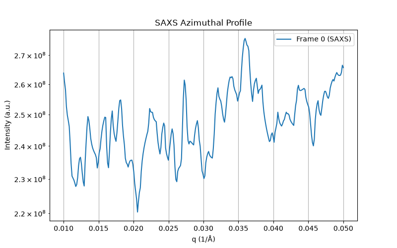

# nexus-s3-server (Go)

HTTP server exposing NeXus/HDF5 files from S3, built on the `gonexus`
library in this repo (`../../gonexus`) and `aws-sdk-go-v2`.

See `../README.md` for the full API reference and configuration
variables — this file only covers building/running the Go binary itself.

## Build

Building `gonexus` requires the HDF5 C headers/libraries (it uses cgo),
same as any other consumer of this library — see the top-level
`README.md`/`Makefile` for platform-specific `CGO_CFLAGS`/`CGO_LDFLAGS`.
On Debian/Ubuntu:

```bash
sudo apt-get install -y libhdf5-dev pkg-config
export CGO_CFLAGS="-I/usr/include/hdf5/serial"
export CGO_LDFLAGS="-L/usr/lib/x86_64-linux-gnu/hdf5/serial"

# from the repo root
go build -o nexus-s3-server ./servers/go/
```

## Run
To access S3 storage we need to set it up. For this we can use either minio or
versitygw. Here is how to run your versitygw pointing to your local file system
path:
```
# use HTTP protocol
ROOT_ACCESS_KEY=myaccess ROOT_SECRET_KEY=mysecret ./versitygw posix /Users/vk/Work/CHESS/FOXDEN/s3

# use HTTPs protocol
ROOT_ACCESS_KEY=myaccess ROOT_SECRET_KEY=mysecret ./versitygw --cert $PWD/server.crt --key $PWD/server.key --port :7070 posix /Users/vk/Work/CHESS/FOXDEN/s3
```

Now, we can start our go server with proper configuration:

```bash
# setup all env variables configuring access to S3 server
export S3_BUCKET=nexus-data
export S3_PREFIX=chess/
export S3_ENDPOINT=http://127.0.0.1:7070
export S3_FORCE_PATH_STYLE=true
export AWS_ACCESS_KEY_ID=myaccess
export AWS_SECRET_ACCESS_KEY=mysecret
export AWS_REGION=us-east-1

bin/nexus-s3-server
# nexus-s3-server listening on :8080 (bucket=nexus-data prefix="chess/" cache=/tmp/nexus-cache)

# or, if you setup your config.yaml (see provided example) you can run
bin/nexus-s3-server -config config.yaml
```

```bash
curl http://localhost:8080/healthz
curl http://localhost:8080/files
curl "http://localhost:8080/tree?key=chess/edd_test.nxs"
```

## Layout

| File | Purpose |
|---|---|
| `main.go` | HTTP server, routing, request handlers |
| `config.go` | Environment-variable configuration |
| `s3store.go` | S3 listing + ETag-based local disk cache |
| `nexusview.go` | Turns a `*gonexus.NXgroup` into the JSON shapes in `../README.md` |
| `errors.go` | Small `apiError` type carrying an HTTP status code |

`main.go` also keeps a small in-process cache of parsed `*gonexus.NXgroup`
trees keyed by local cache path, so repeated requests against the same
file (browsing around one dataset) don't re-parse the HDF5 file on every
call. It's invalidated implicitly whenever `Store.Ensure` downloads a new
copy of the object (a new local path is used, since the file is
re-cached under the same path but the in-memory tree for the *old*
content is simply left to be garbage collected — see the comment on
`treeCache` for the exact behavior).

## APIs
gonexus HTTP server provides the following set of end-points to access NeXus
files:

```
# HTTP endpoints:

GET /healthz
GET /files                                  list available NeXus files
GET /tree?key=...                           full tree, text/plain
GET /entries?key=...                        top-level NXentry groups
GET /group?key=...&path=...                 a group's direct children
GET /field?key=...&path=...&offset=&limit=  a field's metadata + data
```

## Tests

There's no bundled test S3 — during development this was verified against
[moto](https://github.com/getmoto/moto)'s S3 mock (`moto_server`) and
MinIO; both work via `S3_ENDPOINT` + `S3_FORCE_PATH_STYLE=true`. A minimal
local check:

```bash
pip install 'moto[server]'
moto_server -p 5001 &

python3 - <<'EOF'
import boto3
s3 = boto3.client("s3", endpoint_url="http://127.0.0.1:5001",
                   region_name="us-east-1",
                   aws_access_key_id="test", aws_secret_access_key="test")
s3.create_bucket(Bucket="nexus-data")
s3.upload_file("path/to/your.nxs", "nexus-data", "chess/your.nxs")
EOF

S3_BUCKET=nexus-data S3_ENDPOINT=http://127.0.0.1:5001 \
S3_FORCE_PATH_STYLE=true AWS_ACCESS_KEY_ID=test AWS_SECRET_ACCESS_KEY=test \
./nexus-s3-server &

curl "http://localhost:8080/tree?key=chess/your.nxs"
```

---

## Examples using CHESS NeXus file


```
# lookup specific groups in nexus file
http://foxden-dev.classe.cornell.edu:8080/group?key=chess/results.nxs
{
  "key": "chess/results.nxs",
  "path": "",
  "class": "NXroot",
  "attrs": {
    "HDF5_Version": "1.14.2",
    "file_name": "/nfs/chess/scratch/user/kls286/saxswaxs_chap/results.nxs",
    "file_time": "2024-11-05T12:36:50.359295",
    "h5py_version": "3.11.0"
  },
  "children": [
    {
      "name": "entry",
      "type": "group",
      "class": "NXentry"
    },
    {
      "name": "saxs_azimuthal",
      "type": "group",
      "class": "NXprocess"
    },
    {
      "name": "waxs_azimuthal",
      "type": "group",
      "class": "NXprocess"
    }
  ]
}

# look-up entries in nexus file
http://foxden-dev.classe.cornell.edu:8080/entries?key=chess/results.nxs
{
  "key": "chess/results.nxs",
  "root_class": "NXroot",
  "entries": [
    {
      "name": "entry",
      "type": "group",
      "class": "NXentry"
    },
    {
      "name": "saxs_azimuthal",
      "type": "group",
      "class": "NXprocess"
    },
    {
      "name": "waxs_azimuthal",
      "type": "group",
      "class": "NXprocess"
    }
  ]
}

# lookup tree structure of the file
http://foxden-dev.classe.cornell.edu:8080/tree?key=chess/results.nxs

root:NXroot
  @file_name = /nfs/chess/scratch/user/kls286/saxswaxs_chap/results.nxs
  @file_time = 2024-11-05T12:36:50.359295
  @HDF5_Version = 1.14.2
  @h5py_version = 3.11.0
  entry:NXentry
    data:NXdata
      diode = float64(6587)
      ic0 = float64(6587)
      ic1 = float64(6587)
      ic1_ni = float64(6587)
      ic3 = float64(6587)
      icv_hi = float64(6587)
      icv_lo = float64(6587)
      mcs0 = float64(6587)
      xrfx = float64(6587)
      xrfz = float64(6587)
    scan_number = 1
    spec_file = /nfs/chess/scratch/user/kls286/saxswaxs_chap/space_x_line
  saxs_azimuthal:NXprocess
    config = {"tool_type": "integration", "title": "saxs_azimuthal", "integration_type": "azimuthal", "detectors": [{"prefix": "PIL5", "poni_file": "/nfs/chess/auxiliary/reduced_data/cycles/2024-3/id3b/koerner-4187-a/setup/AgBe_10.30.2024.poni", "mask_file": "/nfs/chess/auxiliary/reduced_data/cycles/2024-3/id3b/koerner-4187-a/setup/PIL5_mask.tif", "mask_above": null, "attrs": {}, "shape": [619, 487]}], "radial_units": "q_A^-1", "radial_min": 0.01, "radial_max": 0.05, "radial_npt": 300, "azimuthal_units": "chi_deg", "azimuthal_min": -180.0, "azimuthal_max": 180.0, "azimuthal_npt": 181, "include_errors": true, "right_handed": true, "sequence_index": null}
    data:NXdata
      I = int64(6587x300)
        @units = a.u
        @long_name = Intensity (a.u)
      radial = float64(300)
    date = 2024-11-05T12:36:50.227246
  waxs_azimuthal:NXprocess
    config = {"tool_type": "integration", "title": "waxs_azimuthal", "integration_type": "azimuthal", "detectors": [{"prefix": "PIL9", "poni_file": "/nfs/chess/auxiliary/reduced_data/cycles/2024-3/id3b/koerner-4187-a/setup/LaB6_PIL9_10.30.2024.poni", "mask_file": "/nfs/chess/auxiliary/reduced_data/cycles/2024-3/id3b/koerner-4187-a/setup/PIL9_mask.tif", "mask_above": null, "attrs": {}, "shape": [619, 487]}, {"prefix": "PIL11", "poni_file": "/nfs/chess/auxiliary/reduced_data/cycles/2024-3/id3b/koerner-4187-a/setup/LaB6_PIL11_10.30.2024.poni", "mask_file": "/nfs/chess/auxiliary/reduced_data/cycles/2024-3/id3b/koerner-4187-a/setup/PIL11_mask.tif", "mask_above": null, "attrs": {}, "shape": [619, 487]}], "radial_units": "q_A^-1", "radial_min": 0.6, "radial_max": 4.1, "radial_npt": 300, "azimuthal_units": "chi_deg", "azimuthal_min": -180.0, "azimuthal_max": 180.0, "azimuthal_npt": 360, "include_errors": true, "right_handed": true, "sequence_index": null}
    data:NXdata
      I = int64(6587x300)
        @units = a.u
        @long_name = Intensity (a.u)
      radial = float64(300)
    date = 2024-11-05T12:36:50.227660

# fetching specific data
http://foxden-dev.classe.cornell.edu:8080/field?key=chess/results.nxs&path=/saxs_azimuthal/data/radial

{
  "key": "chess/results.nxs",
  "path": "/saxs_azimuthal/data/radial",
  "dtype": "float64",
  "shape": [
    300
  ],
  "offset": 0,
  "count": 300,
  "total": 300,
  "truncated": false,
  "values": [
    0.01,
    0.010133779264214047,
    0.010267558528428094,
    ...
    0.05
  ]
}

# fetch portion of the data
http://foxden-dev.classe.cornell.edu:8080/field?key=chess/results.nxs&path=/saxs_azimuthal/data/radial&offset=0&limit=10

{
  "key": "chess/results.nxs",
  "path": "/saxs_azimuthal/data/radial",
  "dtype": "float64",
  "shape": [
    300
  ],
  "offset": 0,
  "count": 10,
  "total": 300,
  "truncated": true,
  "values": [
    0.01,
    0.010133779264214047,
    0.010267558528428094,
    0.010401337792642141,
    0.010535117056856188,
    0.010668896321070234,
    0.01080267558528428,
    0.010936454849498328,
    0.011070234113712375,
    0.011204013377926422
  ]
}
```

Now with this concrete example we can access our data for further analysis
using the following [python client](../../examples/http/py_client.py):

```
import matplotlib.pyplot as plt
import numpy as np
import requests

# Server and Dataset details
BASE_URL = "http://foxden-dev.classe.cornell.edu:8080/field"
KEY = "chess/results.nxs"

# ---------------------------------------------------------
# Example A: Fetch a 1D Slice (Radial axis slice)
# ---------------------------------------------------------
radial_params = {
    "key": KEY,
    "path": "/saxs_azimuthal/data/radial",
    "offset": 50,  # Start index
    "limit": 100,  # Fetch 100 points
}

response = requests.get(BASE_URL, params=radial_params)
response.raise_for_status()
data = response.json()

# Convert JSON array directly to a NumPy array with the right data type
radial_slice = np.array(data["values"], dtype=data["dtype"])

print(f"Radial Slice shape: {radial_slice.shape}")
print(f"First 5 radial values: {radial_slice[:5]}")

# ---------------------------------------------------------
# Example B: Fetch a Slice of 2D Intensity Data (I)
# ---------------------------------------------------------
# For 2D datasets (shape [6587, 300]), offset/limit pagination fetches array elements
intensity_params = {
    "key": KEY,
    "path": "/saxs_azimuthal/data/I",
    "offset": 0,
    "limit": 300,  # Fetch first row/frame (300 intensity values)
}

resp_I = requests.get(BASE_URL, params=intensity_params)
resp_I.raise_for_status()
data_I = resp_I.json()

# Convert intensity slice to NumPy array
intensity_slice = np.array(data_I["values"], dtype=data_I["dtype"])

print(f"Intensity Slice shape: {intensity_slice.shape}")

# ---------------------------------------------------------
# Example C: Plotting SAXS Intensity vs. Radial Data
# ---------------------------------------------------------
# Fetch full 300 points for matching radial and intensity line slice
full_radial = requests.get(
    BASE_URL,
    params={
        "key": KEY,
        "path": "/saxs_azimuthal/data/radial",
        "offset": 0,
        "limit": 300,
    },
).json()["values"]
full_I = requests.get(
    BASE_URL,
    params={"key": KEY, "path": "/saxs_azimuthal/data/I", "offset": 0, "limit": 300},
).json()["values"]

q_vec = np.array(full_radial)
I_vec = np.array(full_I)

plt.figure(figsize=(8, 5))
plt.plot(q_vec, I_vec, label="Frame 0 (SAXS)")
plt.xlabel("q (1/Å)")
plt.ylabel("Intensity (a.u.)")
plt.title("SAXS Azimuthal Profile")
plt.yscale("log")
plt.grid(True)
plt.legend()
plt.show()
```

And, our saxs azimuthal data looks like this:


